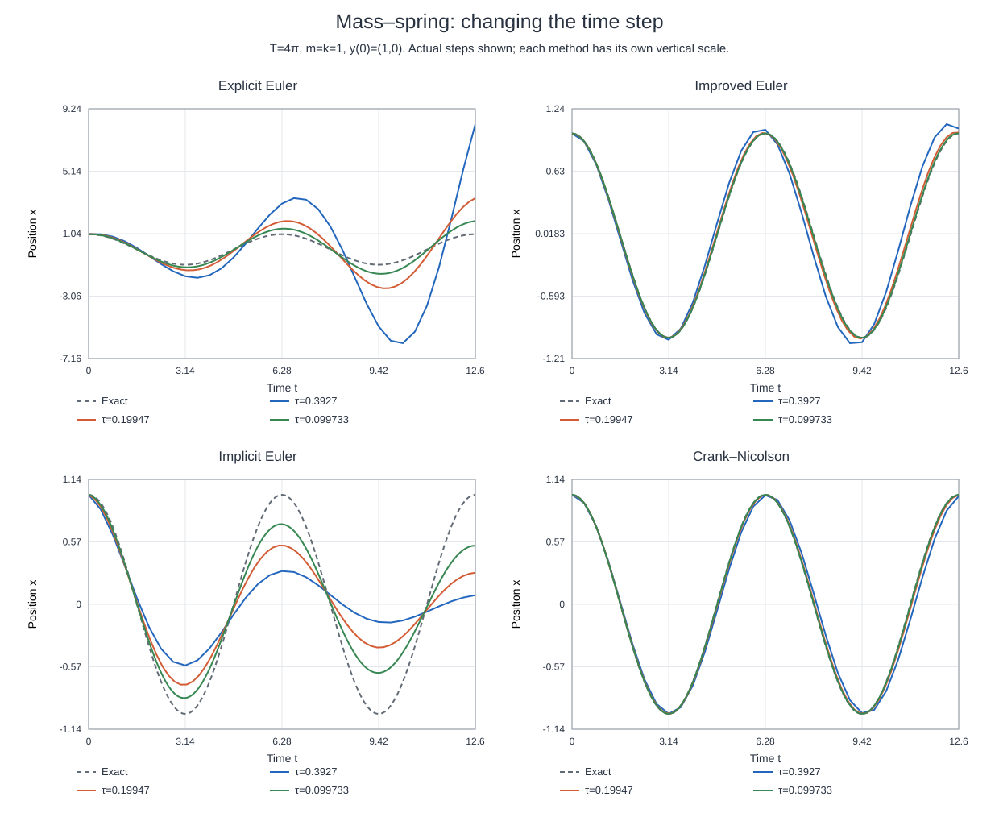
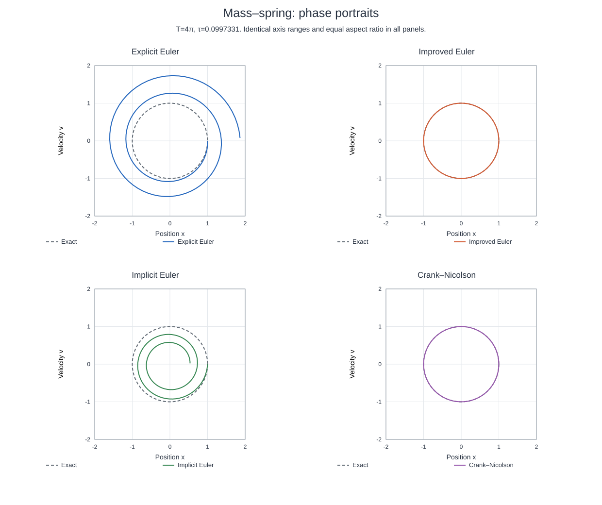
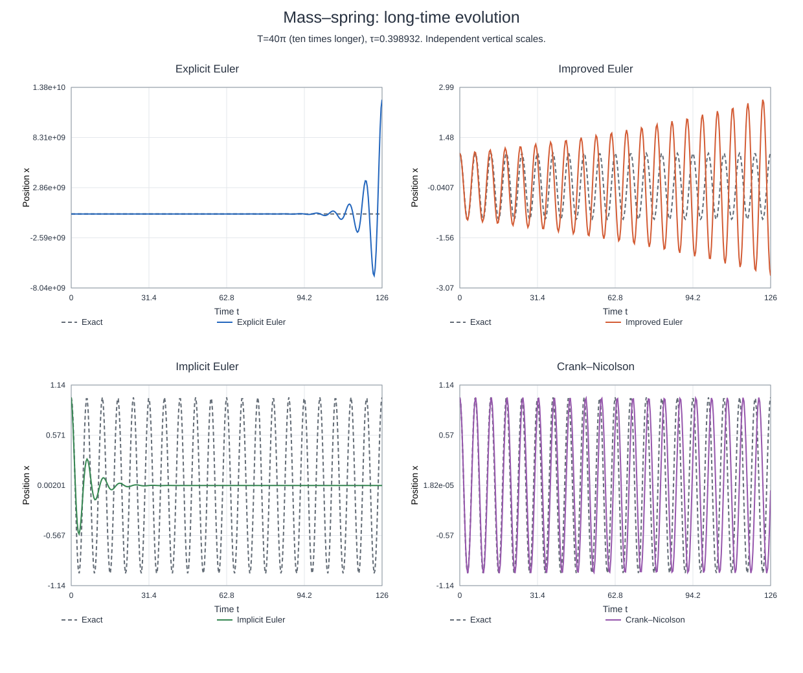
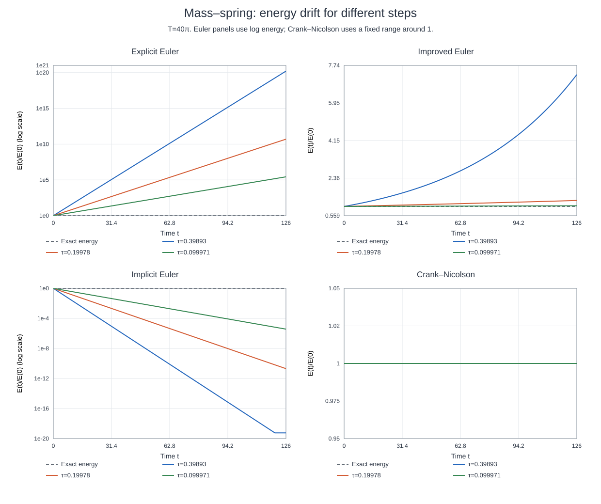
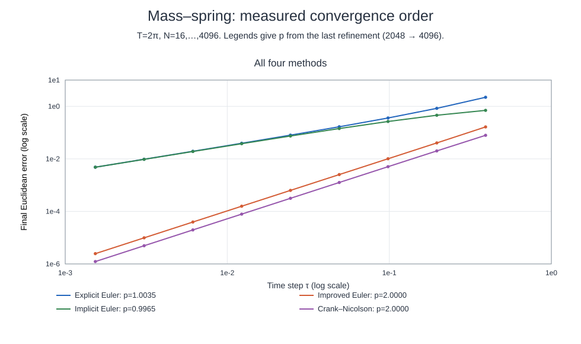
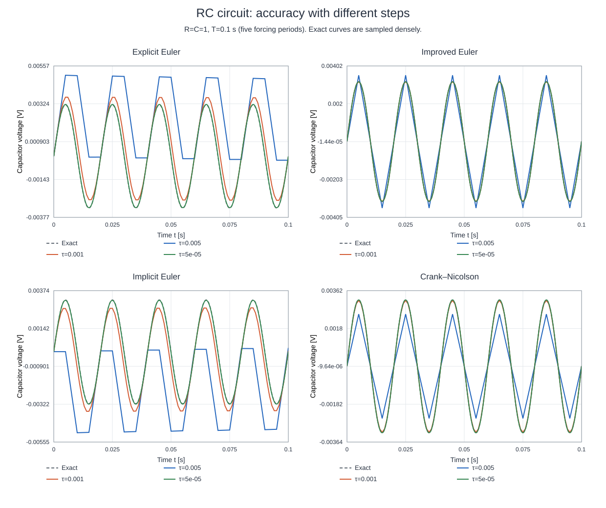
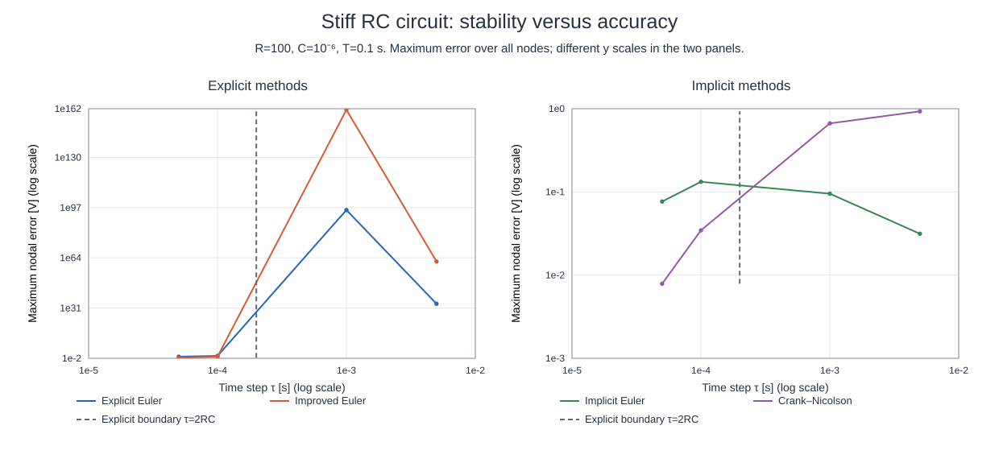
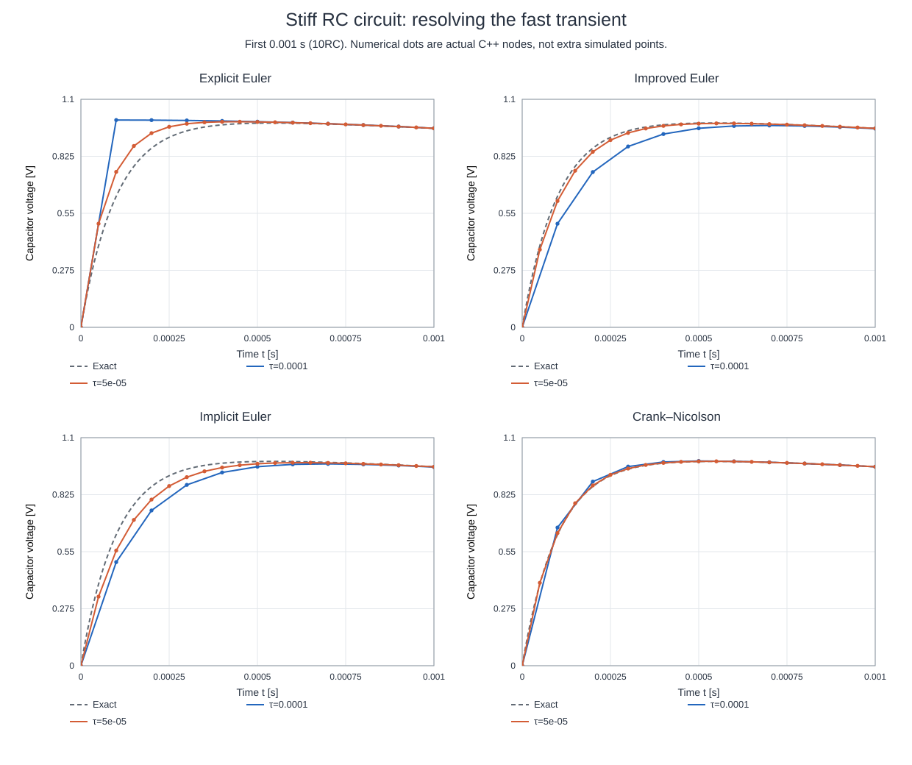
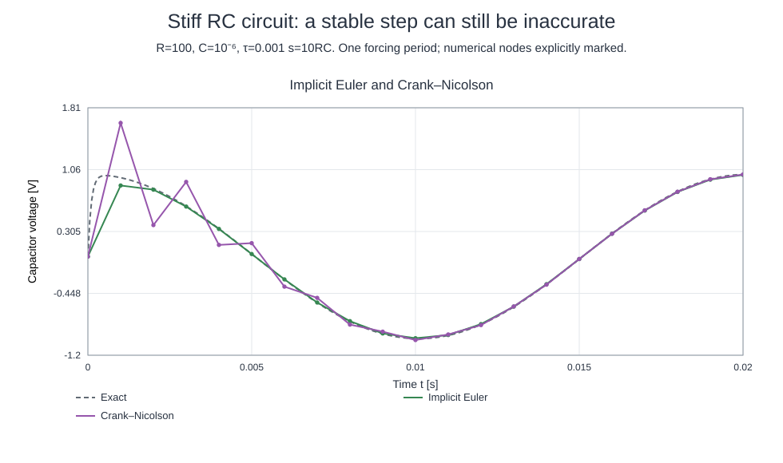

# Euler methods and ODE experiments

This page documents the explicit and implicit Euler implementations based on
the course exercises, then compares them with Improved Euler and
Crank–Nicolson. Improved Euler in ASC-ODE is the **explicit midpoint method**,
not Heun's method.

## Methods

For an autonomous ODE `y' = f(y)`, `src/timestepper.hpp` implements:

- **Explicit Euler:** `y_next = y + h*f(y)`.
- **Improved Euler (explicit midpoint):**
  `y_mid = y + h/2*f(y)`, then `y_next = y + h*f(y_mid)`.
- **Implicit Euler:** Newton's method solves
  `y_next - y - h*f(y_next) = 0`.
- **Crank–Nicolson (trapezoidal rule):** Newton's method solves
  `y_next - y - h/2*(f(y) + f(y_next)) = 0`.

Crank–Nicolson here is the trapezoidal rule, not the implicit midpoint rule.
The formulas differ for nonlinear functions; the test suite checks this
distinction. The implicit methods reuse their composed nonlinear functions
and update their step parameters on each call. Newton starts from the previous
state.

## Mass–spring system

`src/ode_models.hpp` defines `MassSpring`. With mass `m = 1`, stiffness
`k = 1`, and initial state `(x, v) = (1, 0)`, the system is
`x' = v`, `v' = -x`. Its exact solution is `(cos(t), -sin(t))`, and its energy
is `E = (x² + v²)/2`.

The mass–spring experiment compares all four methods at nominal step sizes
`0.4`, `0.2`, and `0.1`, and end times `4π` and `40π`. Each step is adjusted
to land exactly on the requested end time. The recorded results include time
evolution, phase portraits, final errors, and energy ratios. The plots include
the exact solution and use independent panel scales so rapidly growing
explicit Euler results do not hide the bounded curves.

For `T = 4π` and `h ≈ 0.0997331`, the measured results are:

| Method | Final error | `E(T)/E(0)` |
| --- | ---: | ---: |
| Explicit Euler | 0.867377 | 3.48020 |
| Improved Euler | 0.0208441 | 1.00312 |
| Implicit Euler | 0.464949 | 0.287339 |
| Crank–Nicolson | 0.0104006 | 1.00000 |

Explicit Euler spirals outward and gains energy. Improved Euler also gains
energy, but more slowly. Implicit Euler spirals inward and damps this
undamped physical system. Crank–Nicolson preserves the energy of this linear
oscillator up to round-off and Newton tolerance, but still has phase error.
At `T = 40π` with the largest step, its final error is about `1.454` even
though its energy ratio remains 1: preserving amplitude does not guarantee
phase accuracy.

Newton's method uses an absolute residual tolerance of `1e-10`. In strongly
damped implicit runs, the state can reach the tolerance floor, so tiny final
energies should not be interpreted as arbitrarily precise damping
measurements.

### Time-step comparison, phase portraits and long times

The following figures are a curated selection, rather than one separate
plot for every parameter combination. Every numerical curve comes from the
C++ experiment CSVs. Dashed gray curves show the exact reference; legends
state the **actual** steps, adjusted to reach the specified end time.



*At `T=4π`, nominal steps `0.4, 0.2, 0.1` show how refinement changes
accuracy. Vertical ranges differ between methods so explicit growth does not
hide the other curves.*



*At `T=4π` and actual `τ≈0.0997331`, all panels use identical axis ranges
and equal aspect ratio. The unit circle is the exact solution. Outward and
inward spirals represent numerical energy gain and damping respectively.*



*Increasing the end time to `40π` with nominal `τ=0.4` makes accumulated
amplitude and phase errors visible. The actual step is `τ≈0.3989324`.
Each method has its own vertical scale; this is not a common-amplitude plot.*



*Energy ratios over `T=40π` distinguish explicit growth, slower midpoint
growth, implicit damping and Crank–Nicolson conservation. The two Euler
panels use logarithmic energy scales. The plateau of the most damped implicit
run is the Newton tolerance floor, not physical equilibrium.*

## Convergence order and tests

The convergence study integrates to `T = 2π` with
`N = 2^4, ..., 2^12` steps. It computes
`e(h) = hypot(y_N(0) - 1, y_N(1))` and the observed order
`p = log2(e(h)/e(h/2))`. Errors are compared on logarithmic axes across the
refinements.



*All nine prescribed grids are shown. The legends give the measured order
from the final refinement; this study keeps `T=2π` fixed as requested.*

Measured results for the last refinement (`N = 2048 → 4096`):

| Method | Error at `N = 4096` | `p` |
| --- | ---: | ---: |
| Explicit Euler | 0.0048307703 | 1.0034776 |
| Improved Euler | 2.4641574e-06 | 1.9999998 |
| Implicit Euler | 0.0048075462 | 0.9965251 |
| Crank–Nicolson | 1.2320783e-06 | 1.9999985 |

The expected orders are 1, 2, 1, and 2, respectively. The Catch2 suite checks
`|p - p_expected| <= 0.1` at every refinement whose coarser mesh has at least
512 steps. Coarse meshes are not required to meet this asymptotic-order
tolerance; the first explicit refinement, for example, gives `p ≈ 1.40`,
and the first implicit refinement gives `p ≈ 0.62`.

The test suite also checks variable and zero step sizes, object
reuse, amplification formulas, nonlinear Crank–Nicolson behavior, the RC
Jacobian by finite differences, and RC accuracy including clock advancement.
When adding a method, add it to the typed test cases and declare its expected
order and an independently derived amplification formula.

## RC circuit and autonomous formulation

Ohm's law gives `U_R = R*I`, the capacitor relation gives `I = C*U_C'`, and
Kirchhoff's voltage law gives `U_0 = U_R + U_C`. Therefore,

```text
RC U_C' + U_C = cos(100π t),   U_C(0) = 0.
```

With state `y = (U_C, s)` and `s(0) = 0`, this becomes the autonomous system

```text
U_C' = (cos(ω s) - U_C)/(RC),   s' = 1,   ω = 100π.
Jacobian = [[-1/(RC), -ω sin(ω s)/(RC)], [0, 0]].
```

`RCCircuit` implements the system and its Jacobian. Its exact voltage is

```text
U_C(t) = [cos(ωt) + ωRC sin(ωt) - exp(-t/(RC))] / [1 + (ωRC)²].
```

The RC experiment compares all four methods for `(R, C) = (1, 1)` and
`(100, 10^-6)` through `T = 0.1` (five source periods), using steps
`0.005`, `0.001`, `0.0001`, and `0.00005`. The reported results include final
error, maximum error at the time nodes, and maximum absolute voltage. The
maximum error helps reveal a poorly
resolved transient that a small final error could hide. Plots include the
exact reference as a dashed gray curve and use independent scales.

For the stiff circuit with `h = 0.001`:

| Method | Maximum error on `[0,T]` | Final error |
| --- | ---: | ---: |
| Explicit Euler | 2.66663e95 | 2.66663e95 |
| Improved Euler | 1.90237e161 | 1.90237e161 |
| Implicit Euler | 0.0951751 | 0.00482466 |
| Crank–Nicolson | 0.666109 | 1.64321e-5 |

The two explicit methods are unstable with the two largest steps for this
circuit. Implicit Euler rapidly damps the transient. Crank–Nicolson remains
bounded but produces artificial alternating oscillations when the fast scale
is under-resolved. At `h = 0.00005`, its maximum error is `0.00787167`.
Reducing the step improves resolution of the transient.

### RC accuracy, stability and the fast transient



*For `R=C=1`, nominal steps `0.005, 0.001, 0.00005` cover coarse to fine
resolution of the source period `0.02 s`. The exact voltage is sampled
densely rather than only at the coarse numerical nodes.*



*For `R=100, C=10^-6`, all four prescribed steps are shown. Explicit
methods become unstable beyond the boundary `τ=2RC=0.0002 s` (dashed line).
The two panels have different logarithmic error scales. Lines connect the
four measured cases, not a fitted convergence model; the unstable coarse
errors need not vary monotonically because each run contains a different
number of growing steps. A coarse grid can also miss the initial transient:
a smaller nodal maximum for implicit Euler is not necessarily better
continuous-time accuracy.*



*The window `0≤t≤0.001 s` covers ten RC time constants and reveals a
transient compressed in the full `0.1 s` plot. Steps `0.0001` and `0.00005`
are compared on identical voltage axes. Dots mark actual C++ time nodes;
only the analytic reference is sampled more densely.*



*With `τ=0.001 s=10RC`, both implicit methods are stable, but
Crank–Nicolson alternates around the fast transient. Showing the first source
period (`0.02 s`) makes that oscillation visible instead of relying only on
the small error at the final time.*

## Reproducing the published figures

From the ASC-ODE repository root, first configure and build the C++ targets
with CMake and the existing `nanoblas`/`pybind11` prerequisites. Then run:

```sh
(cd build && ./test_ode > massspring_summary.txt && ./convergence > convergence_summary.txt && ./test_rc > rc_summary.txt)
python3 demos/plotreport.py --data-dir build --output-dir docs/pictures
python3 -B -m unittest discover -s tests -p 'test_plotreport.py'
```

`plotreport.py` uses only Python's standard library and writes the nine SVGs
embedded above. It reads the generated CSVs without re-integrating an ODE
or adding synthetic numerical samples. Full data and per-run plots can stay
in the ignored `build/` directory; the selected SVGs in `docs/pictures/`
are small, versionable assets for GitHub and the documentation site. The
original plotting scripts remain available for the full set of per-run plots.

The mass–spring comparison already includes two end times differing by a
factor of ten, as requested. RC time-window zooms reuse the same solutions;
no additional RC end time is needed to satisfy the exercises.

## Stability functions

For `y' = λy`, a one-step method has the form `y_next = R(z)y`, where
`z = hλ`:

| Method | `R(z)` | Order |
| --- | --- | ---: |
| Explicit Euler | `1 + z` | 1 |
| Improved Euler | `1 + z + z²/2` | 2 |
| Implicit Euler | `1/(1 - z)` | 1 |
| Crank–Nicolson | `(1 + z/2)/(1 - z/2)` | 2 |

For the oscillator, `λ = ±i`:

```text
|R_exp(ih)|² = 1 + h²
|R_improved(ih)|² = 1 + h⁴/4
|R_implicit(ih)|² = 1/(1 + h²)
|R_CN(ih)|² = 1
```

These factors explain the energy changes above. For the RC circuit, the
homogeneous component has `λ = -1/(RC)`. Both explicit methods require
`0 <= h/(RC) <= 2` for absolute stability on this real mode, and strict
damping requires `< 2`. This stability condition does not guarantee
accuracy for the oscillating source. Both implicit methods are A-stable, but
only implicit Euler is L-stable: as `z → -∞`, its stability function tends
to 0, while Crank–Nicolson's tends to -1. This explains why Crank–Nicolson
can alternate in sign and damp very fast modes slowly.

- For `(R, C) = (1, 1)`, the time constant is `RC = 1 s`; there is no fast
  decay mode, and resolving the source period (`0.02 s`) sets the step size.
- For `(R, C) = (100, 10^-6)`, `RC = 10^-4 s`, much shorter than the source
  period. This is the stiff case. Explicit methods need `h < 2·10^-4 s` to
  damp the fast mode, even when only the later response is of interest.

The experiments illustrate that stability and accuracy are distinct:
a stable method can still be inaccurate if the step does not resolve the
source or transient.
